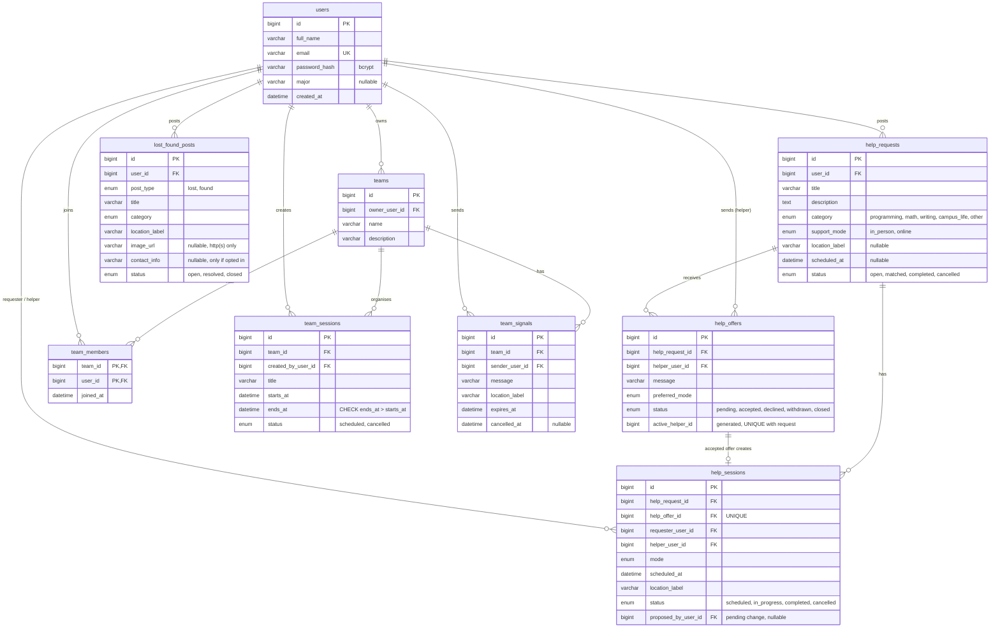

# 24003-p3-CampusLink-PhucHuy

# CampusLink

A website that helps students connect, support each other and organize study activities on campus:
ask for help and offer help, run help sessions, join study teams, and post lost or found items.

The project is split into three parts:

| Folder | What it is | Stack |
| --- | --- | --- |
| [`frontend/`](frontend/) | The website people use | Next.js 16 (App Router) · React 19 · Tailwind CSS 4 |
| [`backend/`](backend/) | JSON REST API with all business rules | Node.js · Express 5 · `express-session` · `bcryptjs` |
| [`database/`](database/) | Schema, sample data and setup script | MySQL 8 (`mysql2`, prepared statements) |

The UI follows the **Neo-Academic Cyberdeck** design system from the Stitch project *CampusLink Student Portal*
(dark surfaces, cyan/violet/emerald accents, Space Grotesk + Plus Jakarta Sans + JetBrains Mono).
Its tokens live in [`frontend/src/app/globals.css`](frontend/src/app/globals.css).

```
Browser ──> Next.js (port 5173) ──/api/*──> Express API (port 3000) ──> MySQL
```

The browser only talks to Next.js; Next.js forwards every `/api/*` request to Express
(`rewrites` in [`frontend/next.config.mjs`](frontend/next.config.mjs)). Pages and API share one origin,
so the login cookie works without any CORS setup.

---

## 1. Setup guide

### 1.1 Requirements

| Tool | Version | Check with |
| --- | --- | --- |
| Node.js | 20 or later | `node -v` |
| MySQL Server | 8.0.16 or later (needs `CHECK` constraints) | `mysql --version` |
| Git | any | `git --version` |

Installing MySQL:

- **macOS (Homebrew):** `brew install mysql` then `brew services start mysql`
- **Windows:** install *MySQL Installer* from mysql.com, choose “Server only” or “Developer Default”, and remember the root password you set.
- **Check it runs:** `mysql -u root -p -e "SELECT VERSION();"`

### 1.2 Install and configure

The repository is an npm workspace: one `npm install` at the root installs all three parts.

```bash
git clone <your-repo-url> campuslink
cd campuslink
npm install
cp backend/.env.example backend/.env     # Windows (PowerShell): Copy-Item backend/.env.example backend/.env
```

Open `backend/.env` and fill in:

| Variable | Meaning | Example |
| --- | --- | --- |
| `PORT` | Port the API runs on | `3000` |
| `NODE_ENV` | `development` locally, `production` when deployed (enables secure cookies) | `development` |
| `DB_HOST` / `DB_PORT` | Where MySQL runs | `localhost` / `3306` |
| `DB_USER` / `DB_PASSWORD` | A MySQL account that can create databases | `root` / *(your password)* |
| `DB_NAME` | Database name (created by `npm run db:reset`) | `campuslink_db` |
| `SESSION_SECRET` | Long random string used to sign the login cookie | see below |

Generate a session secret:

```bash
node -e "console.log(require('crypto').randomBytes(32).toString('hex'))"
```

If the API does not run on `http://localhost:3000`, start the frontend with `API_URL=http://host:port`.

> **Optional – a dedicated MySQL user** instead of `root`:
> ```sql
> CREATE USER 'campuslink'@'localhost' IDENTIFIED BY 'choose-a-password';
> GRANT ALL PRIVILEGES ON campuslink_db.* TO 'campuslink'@'localhost';
> ```
> Then set `DB_USER=campuslink` and `DB_PASSWORD=choose-a-password`.

### 1.3 Create the database

```bash
npm run db:reset
```

This creates the database named in `DB_NAME`, then runs `database/schema.sql` (all tables) and
`database/seed.sql` (sample data). **It deletes all existing CampusLink data in that database**, so run it
again whenever `database/schema.sql` changes.

### 1.4 Run

```bash
npm run dev              # API (port 3000) + website (port 5173), both reload on save
npm run dev:backend      # only the API
npm run dev:frontend     # only the website

npm run build            # production build of the website
npm start                # API + website in production mode (run `npm run build` first)
```

Open <http://localhost:5173>.

### 1.5 Sample accounts

All accounts in `database/seed.sql` use the password `Password123`.

| Email | What the sample data gives them |
| --- | --- |
| `an@student.test` | Owns a request with 2 pending offers, helper in a scheduled session (with a proposal waiting), owns *Web Dev Study Group* |
| `binh@student.test` | Requester in that session (has to answer the proposal), owns *Calculus II Crew* |
| `chau@student.test` | Owns *Morning Runners* and *English Writing Circle*, has Lost & Found posts |

### 1.6 Troubleshooting

| Problem | Fix |
| --- | --- |
| `Could not connect to MySQL: Access denied` | Wrong `DB_USER` / `DB_PASSWORD` in `backend/.env` |
| `Could not connect to MySQL: connect ECONNREFUSED` | MySQL isn’t running (`brew services start mysql`, or start the MySQL service on Windows) |
| `SESSION_SECRET is missing` | Add `SESSION_SECRET=...` to `backend/.env` |
| `EADDRINUSE: address already in use` | Another app uses port 3000 or 5173 – change `PORT` (and set `API_URL` for the frontend) |
| The website shows “can’t reach its API” | The API isn’t running – start it with `npm run dev:backend` |
| `Check constraint ... is violated` / `Unknown column` | Your database is older than the code – run `npm run db:reset` |
| “Your session has expired” | The API restarted (sessions are kept in memory). Refresh the page and log in again |

---

## 2. Database design

All tables use InnoDB, `BIGINT UNSIGNED` primary keys, `utf8mb4`, and foreign keys.
Full definitions with comments: [`database/schema.sql`](database/schema.sql).



### Status flows

```
Help request:  open ──accept offer──> matched ──session completed──> completed
                 │                       └──session cancelled──> owner reopens (open) or cancels
                 └──owner cancels──> cancelled

Help offer:    pending ──> accepted | declined | withdrawn | closed (another offer accepted / request cancelled)

Help session:  scheduled ──start──> in_progress ──complete──> completed
                   └──────────cancel──────┴──> cancelled
               (while scheduled, either side proposes new mode/time/place; the other accepts)

Lost & Found:  open <──> resolved, open <──> closed   (owner can reopen)
```

### Rules the database enforces itself

- `users.email` is unique.
- One **active** offer per helper per request: `UNIQUE (help_request_id, active_helper_id)`, where
  `active_helper_id` is a generated column that is NULL once the offer is no longer pending/accepted.
- One session per accepted offer: `UNIQUE (help_offer_id)`.
- A user can join a team once: primary key `(team_id, user_id)`.
- Team sessions must end after they start: `CHECK (ends_at > starts_at)`.

---

## 3. Pages (frontend)

| Page | URL | Who can open it |
| --- | --- | --- |
| Home | `/` | Everyone |
| Find Help (search, filters, sort, pages) | `/help` | Everyone |
| Help request (+ send an offer) | `/help/:id` | Everyone; offers only for the owner, own offer for the helper |
| Post / edit request | `/help/new`, `/help/:id/edit` | Logged in / owner |
| My offers | `/offers` | Logged in |
| Help sessions | `/sessions`, `/sessions/:id` | The two participants |
| Study Teams | `/teams`, `/teams/:id` | Everyone (members also see members, sessions, signals) |
| Create / edit team | `/teams/new`, `/teams/:id/edit` | Logged in / owner |
| Team session / event | `/teams/:id/sessions/...` | Team members |
| Lost & Found | `/lost-found`, `/lost-found/:id` | Everyone |
| Post / edit Lost & Found | `/lost-found/new`, `/lost-found/:id/edit` | Logged in / owner |
| Sign up, Log in | `/register`, `/login` | Guests |
| My Account | `/account`, `/account/edit` | Logged in (own data only) |

## 4. REST API (backend)

All endpoints live under `/api` and speak JSON. Requests that change data (`POST`, `PUT`, `PATCH`) need the
session cookie and an `X-CSRF-Token` header with the token from `GET /api/auth/me`.

| Method | Endpoint | Description |
| --- | --- | --- |
| GET | `/api/health` | `{ "status": "ok" }` |
| GET | `/api/meta` | Categories, statuses, sort options… with display labels |
| GET | `/api/home` | Latest requests, featured teams, latest Lost & Found, counts |
| GET | `/api/auth/me` | Logged-in user (or `null`) + CSRF token |
| POST | `/api/auth/register` · `/login` · `/logout` | Account and session |
| GET · PUT | `/api/account` | My Account data · update name/major |
| GET · POST | `/api/help-requests` | List (query: `q`, `category`, `mode`, `status` (default `open`, or `all`), `sort`, `page`) · create |
| GET · PUT | `/api/help-requests/:id` | Detail (+ offers/own offer/session for the viewer) · edit |
| POST | `/api/help-requests/:id/cancel` · `/reopen` · `/offers` | Owner actions · send an offer |
| GET | `/api/offers` | My offers |
| POST | `/api/offers/:id/accept` · `/decline` · `/withdraw` | Offer actions (accept answers with the new session id) |
| GET | `/api/sessions` · `/api/sessions/:id` | My help sessions · one session (participants only) |
| POST | `/api/sessions/:id/start` · `/complete` · `/cancel` | Session lifecycle |
| POST | `/api/sessions/:id/proposal` (+ `/accept` · `/decline` · `/withdraw`) | Agree on new details |
| GET · POST | `/api/teams` | List (query: `q`, `page`) · create |
| GET · PUT | `/api/teams/:id` | Team (member-only parts for members) · edit (owner) |
| POST | `/api/teams/:id/join` · `/leave` · `/transfer` | Membership |
| POST | `/api/teams/:id/signals` · `/signals/:signalId/cancel` | Team Signals (members) |
| POST · GET · PUT | `/api/teams/:id/sessions[/:sessionId]` · `.../cancel` | Team sessions/events (members) |
| GET · POST | `/api/lost-found` | List (query: `q`, `type`, `category`, `posted` (`1`/`7`/`30` days), `status`, `page`) · create |
| GET · PUT | `/api/lost-found/:id` | Detail · edit (owner) |
| PATCH | `/api/lost-found/:id/status` | `open` / `resolved` / `closed` (owner) |

```bash
curl "http://localhost:3000/api/help-requests?category=math&mode=online&page=1"
```

Responses:

- Lists: `{ "data": [...], "pagination": { "page", "pageSize", "total", "totalPages" }, "filters": {...} }`
- Errors: `{ "error": "message" }` with status 401 / 403 / 404 / 409 (rule broken, e.g. accepting twice) / 500
- Validation errors: status 422 with `{ "error": "...", "errors": { "field": "message" } }`

---

## 5. Project structure

```
package.json             # npm workspaces + scripts (dev, build, start, db:reset)

backend/
  .env.example           # copy to backend/.env
  src/server.js          # loads .env, checks MySQL, starts listening
  src/app.js             # Express app: JSON, sessions, CSRF, routes, errors
  src/routes/            # URL -> controller (+ which guards apply); index.js mounts everything under /api
  src/controllers/       # reads the request, calls services, answers JSON
  src/services/          # SQL queries and business rules
  src/middleware/        # requireAuth, teamAccess, csrf, errorHandler
  src/validators/        # server-side validation of request bodies
  src/utils/             # list query parsing, errors, date helpers
  src/config/            # MySQL pool + withTransaction(), fixed option lists

frontend/
  next.config.mjs        # forwards /api/* to the backend
  src/app/               # one folder per page (App Router), layout.js, globals.css (design tokens)
  src/components/        # layout (header, footer, flash, guards), ui (forms, chips, pagination...), cards, forms
  src/lib/               # api client, hooks (useApi, useAction), formatting, safe redirects

database/
  schema.sql             # all tables
  seed.sql               # sample data
  setup.js               # npm run db:reset
```

Request flow: browser → Next.js page → `fetch('/api/...')` → Express `routes` → `middleware` → `controllers`
→ `services` (MySQL) → JSON → React renders it.

## 6. Security and privacy

- Passwords are hashed with bcrypt; failed logins show one generic message and take the same time whether or not the email exists.
- The session id is regenerated at login; the cookie is `httpOnly`, `sameSite=lax`, and `secure` in production.
- Every request that changes data must send the session’s CSRF token in the `X-CSRF-Token` header, and bodies must be JSON.
- All SQL uses `?` placeholders. Sort orders and filters come from fixed allow-lists.
- React escapes everything users type, so HTML/JS in posts is shown as text.
- Permissions are checked by the API for every request (owner, participant, team member), and again inside the SQL `UPDATE`.
  The frontend only hides buttons; it is never trusted.
- Multi-step changes (accepting offers, session actions, leaving teams) run in transactions with row locks.
- Emails are never public. A help session shows each participant the other's email; nobody else can open it.
- Lost & Found contact info is stored only when the poster ticks “show my contact info”; photo links must be http(s).
- `returnTo` after login only accepts paths on this site (no open redirects).
- Sessions use the default in-memory store: restarting the API logs everyone out. Use a persistent
  store (e.g. `express-mysql-session`) before deploying.

## 7. Accessibility and responsive design

- Every form field has a label; errors are listed in a summary at the top (focus moves there) and next to each field.
- Pages use landmarks (`header`, `nav`, `main`, `footer`), a skip link and a logical heading order.
- All controls work with the keyboard and show a clear focus outline. Confirmation dialogs are native.
- Layout works from 320 px phones to desktops; the menu collapses below 1024 px.
- Buttons show a spinner and are disabled while a request is sending (no double posts).
- Animations are switched off for people who ask for reduced motion.

Manual checklist before a demo, in Chrome, Firefox and Safari:

1. Sign up, log out, log in again (and get redirected back to the page you wanted).
2. Post a help request; from another account offer help; accept it; agree on details; start and complete the session.
3. Create a team, join it from another account, send a Team Signal, create a session.
4. Post a Lost & Found item with contact info; mark it resolved.
5. Resize to phone width: open the menu, fill a form, page through a list.
6. Tab through a form with the keyboard only.

---

## 8. Progress

- [x] Milestone 1 — Setup: Express, MySQL connection, layout, Home page
- [x] Milestone 2 — Help requests: list with search/filters/sorting/pagination, detail, create, edit, cancel
- [x] Milestone 3 — Sign up, log in, log out (bcrypt + sessions), protected routes, owner checks, CSRF
- [x] Milestone 4 — Offer Help and Help Sessions (offers, accept/decline, sessions with agreed details, start/complete/cancel, reopen)
- [x] Milestone 5 — Teams (search, join/leave, ownership transfer, members-only sessions/events and Team Signals)
- [x] Milestone 6 — Lost & Found and My Account
- [x] Milestone 7 — Polish: accessibility, responsive layout, loading/empty/error states, documentation
- [x] Milestone 8 — Split into `frontend/` (Next.js, Stitch design system), `backend/` (REST API) and `database/`
